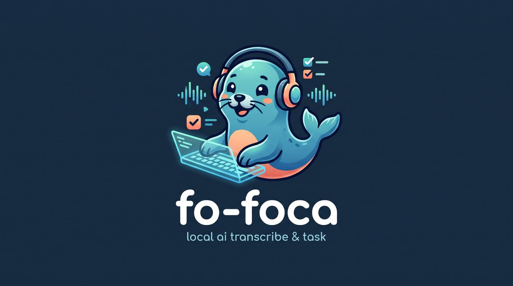
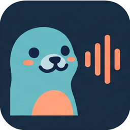
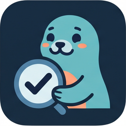
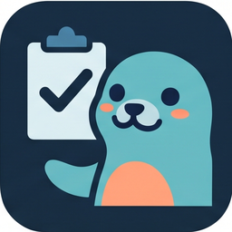
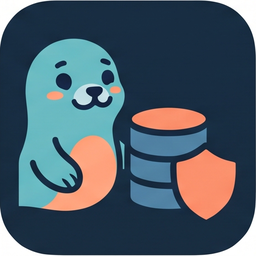
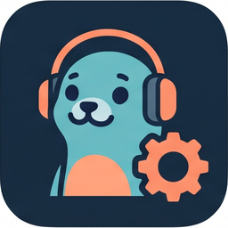
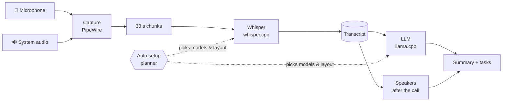

<p align="center">
  
</p>

<p align="center">
  <strong>Private meeting notes that run entirely on your machine — even on a 2&nbsp;GB laptop GPU.</strong><br>
  Records your mic and system audio, transcribes it, and turns it into a summary and a task list.<br>
  No bot joins your call. No cloud. No account.
</p>

<p align="center">
  🚧 <em>Pre-alpha — Linux only. <a href="https://github.com/moacyrricardo/fofoca/releases">Test builds</a> (AppImage / .deb) are available; see <a href="#install">Install</a>.</em> 🚧<br>
  <a href="https://moacyrricardo.github.io/fofoca/"><strong>moacyrricardo.github.io/fofoca</strong></a> — download the newest build and the install steps
</p>

---

> **fofoca** is Brazilian Portuguese for *gossip* — and **foca** means *seal*. A seal that listens to
> your meetings and tells you what was said. 🦭

## Why

Local meeting-notes apps exist, but most assume a big GPU or an Apple Silicon Mac. On an ordinary
laptop they pick models that don't fit, fall back to the CPU, and make the whole machine crawl.

fo-foca starts from the opposite end: **measure what your hardware can actually do, then pick the
best setup that fits** — and let you override it.

It is also built **pt-BR first**: Brazilian Portuguese is a first-class language, not an
afterthought. English works just as well.

## What it does

| | |
|---|---|
|  | **Transcription** — records your microphone and the system audio (Meet, Zoom, Teams, anything) and transcribes it locally with Whisper, live, while you talk. |
|  | **Summary** — a local LLM writes a "summary so far" during the call and a final summary when it ends, grounded in the transcript so every claim can be checked. |
|  | **To-dos & tasks** — action items, decisions, names, numbers and dates pulled out of the meeting. |
|  | **100% local** — audio, transcripts and notes never leave your computer. Models run as local servers on your GPU or CPU. |
|  | **Fits your hardware** — choose where each model runs (GPU, CPU, or both on a 2 GB GPU taking turns); a GPU memory meter shows what fits. *Planned:* fo-foca detects your GPU, VRAM, RAM and CPU, benchmarks the candidate models, and picks the layout for you ([spec 002](specs/002-todo-auto-setup.md)). |
|  | **Fast and light** — a native desktop app (Rust + Tauri), not a browser in a box. |

## How it works



**During the call**

- **Speech-to-text:** [whisper.cpp](https://github.com/ggml-org/whisper.cpp) (`large-v3-turbo` by default), in 30 s chunks.
- **You vs. them:** your mic and the system audio are recorded on separate tracks, so your own lines are labelled from the start.
- **Summary so far:** [llama.cpp](https://github.com/ggml-org/llama.cpp) with a small open-weight model (Qwen3.5 by default), on demand or every few minutes.

**After the call**

- **Speakers:** the system-audio track is split per speaker (*Pessoa 1*, *Pessoa 2*, …) with a small
  CPU diarization model ([pyannote-rs](https://github.com/thewh1teagle/pyannote-rs)), then aligned
  with the transcript. Rename speakers afterwards — participant names from the calendar invite are suggested.
- **Final summary & tasks** over the full, speaker-labelled transcript.

Models run as **separate local server processes**, so fo-foca can load, unload and swap them
without restarting — and you can update them independently.

### Fitting models on small GPUs

When everything fits in VRAM, both models stay loaded. When it doesn't, fo-foca **swaps** them:
Whisper stays on the GPU while you talk, and the LLM is swapped in for summaries — switching costs
about 3 seconds. Today you pick the layout in **Settings → Processing**, with a GPU memory meter
for each choice. **Planned** ([spec 002](specs/002-todo-auto-setup.md)): choosing it automatically —

1. **Detect** — enumerate GPUs (preferring a discrete card with its own VRAM), read *free* VRAM, RAM and CPU threads.
2. **Plan** — choose a layout from *measured* model footprints (not file sizes), with a safety margin.
3. **Verify** — load the chosen models and benchmark a short sample on first run.
4. **Fall back** — if a load runs out of memory, step down to the next layout and say so.

Settings will show what was chosen and why, and every piece (device, models, context size, layout,
summary cadence) can be overridden.

## Reference numbers

Measured on the project's baseline machine — an i7-10510U laptop with an **NVIDIA MX230 (2 GB)**,
using whisper.cpp and llama.cpp on Vulkan:

| What | Result |
|---|---|
| Whisper `large-v3-turbo` q5_0 on GPU | 824 MiB VRAM · ~0.36× real time on a whole file · ~0.59× per 30 s chunk |
| pt-BR word error rate (read speech with slang, jargon and numbers) | **~2 %** (vs ~12 % for Whisper `small`) |
| Qwen3.5-2B Q4_K_M on GPU | 1.4–1.6 GB VRAM (8K–32K context) · ~17 tokens/s |
| Swap Whisper ⇄ LLM | ~3 s |
| Both models on the GPU at once | ✗ doesn't fit in 2 GB → swap layout |

## Status & roadmap

Mirrors [`specs/CATALOG.md`](specs/CATALOG.md) — `done` is checked, `todo` is open, a concern is
*exploring*. Spec numbers in brackets.

- [x] Feasibility research and benchmarks on a 2 GB GPU (001)
- [x] Live transcript — mic and call on separate tracks, voice detection, adaptive chunks (001, 010)
- [x] Summary so far, and a final summary and tasks checked against the transcript (001, 005)
- [x] Speaker separation after the call, with names suggested from the invite (003, 022)
- [x] After the call, mic and call transcribed separately, re-run on demand (020)
- [x] Calendar via a private iCal link (004)
- [x] Meeting labels, set automatically from the calendar (007, 009)
- [x] Pause and resume a recording (010)
- [x] Import a recording made elsewhere (012)
- [x] Replay a meeting with its audio (011, 014)
- [x] Settings: where each model runs (GPU / CPU / swap), model downloads (015)
- [x] Tasks across meetings, filtered by label (016)
- [x] Tray icon: start, stop, show / hide (017)
- [x] Export a meeting: transcript, notes, tasks, audio (023)
- [ ] Live transcript per track during the call ([018](specs/018-todo-per-track-transcription.md))
- [ ] Auto setup: hardware probe, layout planner, first-run benchmark ([002](specs/002-todo-auto-setup.md))
- [ ] Packaging: AppImage and .deb test builds are out; engines are not bundled yet ([006](specs/006-todo-packaging-model-servers.md)). Then Windows and macOS
- [ ] *Exploring:* a local MCP server so assistants can read your meetings ([008](specs/008-concern-mcp-server.md))

## Install

Linux x86-64, test builds only. Each build is on the
[Releases page](https://github.com/moacyrricardo/fofoca/releases); the
[project site](https://moacyrricardo.github.io/fofoca/#install) links the newest one and has the same
steps.

1. Install the system pieces (Debian/Ubuntu names):
   ```bash
   sudo apt install pipewire-bin mesa-vulkan-drivers libwebkit2gtk-4.1-0
   ```
   With an NVIDIA GPU, use the NVIDIA driver, which includes Vulkan.
2. Download the models and engines with [`scripts/fofoca-setup.sh`](scripts/fofoca-setup.sh)
   (also attached to each release):
   ```bash
   ./fofoca-setup.sh                # default models (~1.9 GB) + engines
   ./fofoca-setup.sh --small        # smaller models (~1.3 GB)
   ./fofoca-setup.sh --models-only  # you already have whisper-server and llama-server
   ```
   - Everything goes to `~/.local/share/fofoca/`, where the default config looks.
   - `llama-server` (llama.cpp, Vulkan) is downloaded.
   - `whisper-server` is built from source, because whisper.cpp ships no Linux build. That needs
     `sudo apt install git cmake build-essential glslc libvulkan-dev`.
3. Run the AppImage (`chmod +x fo-foca_*.AppImage && ./fo-foca_*.AppImage`), or install the .deb
   (`sudo apt install ./fo-foca_*_amd64.deb`).
4. In **Settings → Models**, check that every row is green, and pick the GPU for each engine.

## Platforms

Linux first (PipeWire). Windows and macOS are planned. Any GPU that works with Vulkan should be
usable — NVIDIA, AMD or Intel — or CPU only.

## Development

Requirements (Linux): Rust, Node 20+, the [Tauri prerequisites](https://tauri.app/start/prerequisites/)
(WebKitGTK 4.1, GTK 3), PipeWire (`pw-record`), and a `whisper-server` (whisper.cpp) and
`llama-server` (llama.cpp) build with their models. Bundling those is [spec 006](specs/006-todo-packaging-model-servers.md);
until then, run [`scripts/fofoca-setup.sh`](scripts/fofoca-setup.sh) or point
`~/.config/fofoca/config.toml` (created on first run) at your own builds.

```bash
cd app && npm install && cargo tauri dev     # desktop app
cargo test -p fofoca-core                    # core tests
cargo run -p fofoca-core --bin fofoca-cli -- transcribe meeting.wav   # headless
cargo run -p fofoca-core --bin fofoca-cli -- record --seconds 60 --summary-at 30
```

Design decisions live in [`specs/`](specs/CATALOG.md).

## Contributing

The project is at the design stage. Ideas, hardware reports ("here's what fits on my GPU") and
pt-BR test recordings are very welcome — open an issue.

## License

[MIT](LICENSE)
